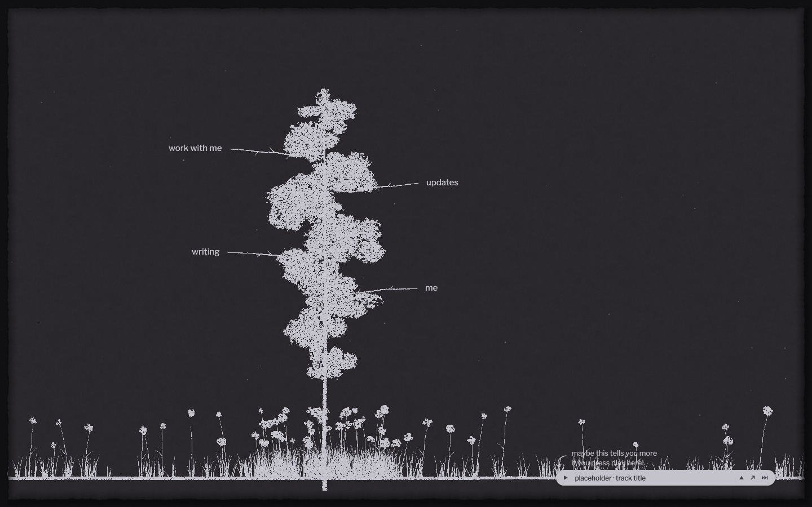

# ink-tree-site

`ink-tree-site` is an interactive personal website built with React, TypeScript, Vite, Three.js, custom GLSL shaders, Motion, and MDX. It draws a procedural tree in lavender ink on dark textured paper. Four branches expand into a bio, project updates, writing links, and contact links, alongside an ambient WebAudio synthesizer and monospace reading pages.



## Quick start

`package.json` does not set an `engines` or `packageManager` field. The lockfile (`pnpm-lock.yaml`) uses lockfile version `9.0`, and the build runs on Node.js `v22.23.1` with pnpm `12.5.1`.

Run these commands from the repository root:

1. Install dependencies:

```bash
pnpm install
```

2. Start the development server on `0.0.0.0:4173`:

```bash
pnpm dev
```

3. Typecheck with `tsc -b` and build the production bundle into `dist/`:

```bash
pnpm build
```

4. Preview the production bundle locally on `0.0.0.0:4173`:

```bash
pnpm preview
```

## Replace placeholder content

Placeholder copy, links, posts, and synthesized audio live in separate data and content files.

### Update profile text, branch links, and track metadata

Edit [`src/data/siteContent.ts`](src/data/siteContent.ts) to replace the site text:

1. Set the page title, author name, email, booking URL, post-page CTA copy, footer links, and music caption lines in `SITE_CONFIG`.
2. Edit the bio paragraphs in `BIO_PARAGRAPHS`. Each segment accepts `mark: true` for a wavy underline or `href` for a clickable link.
3. Adjust card dimensions, rotation, offsets, captions, tape strips, and motifs in `ME_PHOTOS`.
4. Update branch labels, dates, routes, and track presets in `UPDATE_ENTRIES`, `WRITING_POSTS`, `WORK_LINKS`, and `MUSIC_TRACKS`.

### Swap procedural bio cards for images

`createAbstractPhotoTexture` in [`src/tree/proceduralArt.ts`](src/tree/proceduralArt.ts) draws four grayscale Canvas2D studies (`rings`, `horizon`, `monolith`, and `lattice`) before passing them to the halftone shader. To use your own photos, draw an `HTMLImageElement` onto the canvas inside `createAbstractPhotoTexture`. You can also replace the `createAbstractPhotoTexture(photo)` call in [`src/tree/InkTreeScene.ts`](src/tree/InkTreeScene.ts) with `new THREE.TextureLoader().load(url)`.

### Add or edit blog and update posts

Manage MDX posts across three locations:

1. Create or edit `.mdx` files in [`src/content/blog/`](src/content/blog/) and [`src/content/updates/`](src/content/updates/).
2. Export a `meta` object matching `PostMeta` in [`src/types/post.ts`](src/types/post.ts) (`title`, `date`, `slug`, `kind`, and optional `summary`).
3. Import the MDX file and its `meta` export in [`src/content/registry.ts`](src/content/registry.ts), then add a matching route entry to `POSTS`.
4. To customize the inline SVG diagrams used in update posts, edit [`src/components/AbstractStudy.tsx`](src/components/AbstractStudy.tsx).

### Replace the ambient synthesizer and page metadata

- **Audio tracks.** Edit `AmbientSynthPlayer` in [`src/audio/synthPlayer.ts`](src/audio/synthPlayer.ts) to change the WebAudio presets or load audio files, then update `MUSIC_TRACKS` in [`src/data/siteContent.ts`](src/data/siteContent.ts).
- **Document metadata.** Edit [`index.html`](index.html) and [`public/favicon.svg`](public/favicon.svg) to change the tab title, description, and icon.

## Tune the tree, colors, and shaders

### Adjust colors

Edit color values in three places to keep WebGL and DOM elements aligned:

- **Ink color.** Edit `INK_COLOR` in [`src/tree/InkTreeScene.ts`](src/tree/InkTreeScene.ts) (set in `THREE.LinearSRGBColorSpace` from `#c4c3cc`). Update matching `#c4c3cc` rules in [`src/index.css`](src/index.css) and the caption arrow stroke in [`src/components/MusicWidget.tsx`](src/components/MusicWidget.tsx).
- **Paper and surround.** Edit `base` (`#2a282c`) in `PAPER_BG_FRAG` and `surroundCol`, `cutRimCol`, and `bevelCol` in `TORN_FRAME_FRAG` inside [`src/tree/shaders.ts`](src/tree/shaders.ts). Match the `body` background in [`src/index.css`](src/index.css).
- **Halftone cards.** Edit `cardBg` (`#17151a`) in `HALFTONE_PHOTO_FRAG` inside [`src/tree/shaders.ts`](src/tree/shaders.ts).
- **Post pages.** Edit `.post-page` (`#1e1e1e` background, `#d4d4d4` body text, `#ff8800` links) in [`src/index.css`](src/index.css).

### Adjust tree geometry and camera targets

Modify tree proportions, camera framing, and flora density in the scene and geometry modules:

- **Canopy clusters.** Edit `clusterDefs` and `canopyRx` inside `InkTreeScene.rebuildWorld` in [`src/tree/InkTreeScene.ts`](src/tree/InkTreeScene.ts).
- **Branches and framing.** Edit `computeBranchSpecs` in [`src/tree/InkTreeScene.ts`](src/tree/InkTreeScene.ts) to move branch heights, twig offsets, and `cameraTarget` values (`x`, `y`, and `zoom`).
- **Ground flora and dust.** Edit the `buildGroundFlora` arguments and `buildDustParticles` count in [`src/tree/InkTreeScene.ts`](src/tree/InkTreeScene.ts), or edit `shrubCenters` and wildflower heights in [`src/tree/geometry.ts`](src/tree/geometry.ts).

### Tune shader grain and border effects

Edit shader constants in [`src/tree/shaders.ts`](src/tree/shaders.ts) to change surface texture and dithering:

- `CANOPY_FRAG` controls foliage density and paper cutouts through `thresh`, `bigVoid`, `innerVoid`, `fineHoleThresh`, and `clusterHoleThresh`.
- `INK_STROKE_FRAG` controls stroke edge roughness and interior speckles through `edgeLimit` and `nFine`.
- `HALFTONE_PHOTO_FRAG` sets the halftone dot pitch (`5.2` pixels) and screen angle (`0.62` radians).
- `TORN_FRAME_FRAG` sets the deckled border width (`marginCss`), tear amplitude (`tearX`, `tearY`), `castShadow`, and `bevelWidth`.

## Project layout

The repository separates the Three.js renderer, site data, and MDX posts into these files and directories:

| Path | Purpose |
| :--- | :--- |
| [`index.html`](index.html) | HTML shell, page title, and favicon link |
| [`package.json`](package.json) | Scripts and dependencies (Vite 6, React 19, Three.js 0.176, Motion 12, TypeScript 5.8) |
| [`vite.config.ts`](vite.config.ts) | Vite configuration with `@mdx-js/rollup` and host settings (`0.0.0.0:4173`) |
| [`tsconfig.json`](tsconfig.json) | Strict TypeScript configuration (`ES2022`, `react-jsx`, `noEmit: true`) |
| [`public/favicon.svg`](public/favicon.svg) | Inline SVG tree icon |
| [`src/App.tsx`](src/App.tsx) | History API router (`pushState` and `popstate`) between home and post pages |
| [`src/main.tsx`](src/main.tsx) | React root mount and local Fontsource CSS imports (`Libre Franklin` and `IBM Plex Mono`) |
| [`src/index.css`](src/index.css) | Global styles, hit-target overlay, music pill, back pill, and `.post-page` styles |
| [`src/data/siteContent.ts`](src/data/siteContent.ts) | Site config, bio paragraphs, photo specs, branch entries, and audio track presets |
| [`src/pages/HomePage.tsx`](src/pages/HomePage.tsx) | WebGL canvas host, synchronized DOM hit targets, keyboard shortcuts, and screen-reader `<nav>` |
| [`src/pages/PostPage.tsx`](src/pages/PostPage.tsx) | Monospace reading template for `/blog/:slug/` and `/updates/:date/` routes |
| [`src/components/BackButton.tsx`](src/components/BackButton.tsx) | Animated bottom-left return pill rendered when a branch is open |
| [`src/components/MusicWidget.tsx`](src/components/MusicWidget.tsx) | Bottom-right (desktop) or bottom-center (mobile) audio pill and caption |
| [`src/components/AbstractStudy.tsx`](src/components/AbstractStudy.tsx) | Geometric SVG figures (`horizon`, `grid`, `rings`) embedded in update MDX files |
| [`src/audio/synthPlayer.ts`](src/audio/synthPlayer.ts) | `AmbientSynthPlayer` WebAudio generator with three presets (`rhodes`, `kalimba`, `rain`) |
| [`src/content/registry.ts`](src/content/registry.ts) | MDX post registry (`POSTS`, `findPostByPath`, `getAllPosts`) |
| [`src/content/blog/`](src/content/blog/) | Blog MDX files (`placeholder-post.mdx`) |
| [`src/content/updates/`](src/content/updates/) | Seven dated update MDX files (`2026-04-20.mdx` through `2026-06-13.mdx`) |
| [`src/tree/InkTreeScene.ts`](src/tree/InkTreeScene.ts) | Three.js scene controller, camera easing, input handlers, and animation loop |
| [`src/tree/geometry.ts`](src/tree/geometry.ts) | Procedural geometry builders for strokes, canopies, thorns, flora, roots, and underlines |
| [`src/tree/rng.ts`](src/tree/rng.ts) | Mulberry32 PRNG (`createRng`), 2D hash, value noise, and FBM helpers |
| [`src/tree/proceduralArt.ts`](src/tree/proceduralArt.ts) | Canvas2D grayscale artwork generator and `Libre Franklin` text texture renderer |
| [`src/tree/shaders.ts`](src/tree/shaders.ts) | Custom GLSL shaders for paper, frame, ink, halftone, tape, text, and dust |
| [`src/types/`](src/types/) | `PostMeta` interface and `*.mdx` module declarations |
| [`docs/experience-spec.md`](docs/experience-spec.md) | Layout, timing, and interaction specification |
| [`docs/verification.md`](docs/verification.md) | Headless Playwright verification report and screenshot index |

## How the rendering works

### Orthographic Three.js scene

`InkTreeScene` renders three passes each frame in `animate`: a background paper pass (`bgScene`), the orthographic tree scene (`scene`), and a torn border overlay (`frameScene`). Splitting the paper and border into separate `OrthographicCamera(-1, 1, 1, -1, 0, 10)` passes locks the deckled sheet edge to the viewport while the tree camera pans and zooms underneath.

`computeVirtualDims` chooses one virtual coordinate space per breakpoint so proportions hold across screen sizes. Viewports narrower than `640` pixels or with an aspect ratio below `0.78` use a fixed `worldW` of `390`, while desktop viewports use a fixed `worldH` of `900`.

WebGL meshes are invisible to assistive technology and browser find-in-page. To keep navigation accessible, `InkTreeScene` projects active hitboxes with `worldToScreen` and passes them to `HomePage`. `HomePage` renders transparent `<button>` and `<a>` elements inside `.tree-hit-layer` over the canvas, paired with an offscreen `<nav class="sr-only">` summary.

### Procedural geometry with seeded RNG

Every stroke, cloud lobe, thorn, wildflower, and root comes from deterministic math rather than static SVG or image assets. `createRng` in [`src/tree/rng.ts`](src/tree/rng.ts) implements a Mulberry32 generator, and `fbm2D` sums octaves of smoothstepped 2D value noise.

`sampleOrganicPath` fits a Catmull-Rom spline through control points and offsets interior samples with endpoint-anchored `fbm2D` noise so endpoints stay fixed. `buildStrokeGeometry` extrudes a tapered triangle-strip ribbon along each polyline and writes cumulative normalized arc length to `uv.x` for draw-in animation and sway.

For foliage, `generateCanopyCluster` scatters overlapping ellipses around an offset core. `InkTreeScene.filterCanopyBlobs` drops or shrinks blobs inside a `10`-pixel margin around branch labels and outer twig tips. It then runs a breadth-first search from blobs near `trunkX` so no detached ink ovals remain.

### GLSL shaders

All shaders in [`src/tree/shaders.ts`](src/tree/shaders.ts) compute noise in GLSL using `hash21`, `vnoise`, and 4-octave `fbm` rather than sampling external noise textures. That keeps the bundle small and avoids extra texture bindings, though the micro-grain is more uniform across scales than scanned paper stamps.

Each shader handles one visual pass or mesh type:

- `PAPER_BG_FRAG` adds fine grain and fiber noise to `#2a282c`, shifted by `uPanOffset` so the paper appears to move when you drag the sheet.
- `TORN_FRAME_FRAG` normalizes coordinates by `uPixelRatio` and evaluates `tornMarginDist` for the deckled margin. It draws the darker outer surround with a down-right cast shadow, then shades an inner bevel inside the cut edge.
- `INK_STROKE_FRAG` clips fragments past `uProgress` along `vUv.x`, erodes the ribbon boundary with `fbm` and `vnoise`, and punches sparse paper pinholes.
- `CANOPY_FRAG` perturbs blob radii with angular noise and cuts interior voids (`bigVoid` and `innerVoid`) so the trunk and paper show through. Above `1.3` DPR, it scales grain by `uPixelRatio` and lowers pinhole thresholds so high-DPI screens avoid oversized dark dots.
- `HALFTONE_PHOTO_FRAG` converts `CanvasTexture` luminance into a dot screen rotated by `0.62` radians at a `5.2`-pixel pitch over `#17151a` card stock.
- `INK_TEXT_FRAG` draws Canvas2D text quads and fades fragments near `uClipY.x` and `uClipY.y` so the `me` bio column scrolls behind a soft fold above the ground grass.

### Camera navigation

Clicking a branch label calls `InkTreeScene.selectBranch`, which sets `camTarget` and `camTargetZoom` to that branch's desktop or mobile framing. Each frame, `animate` interpolates `camPos` and `camZoom` using `1 - Math.exp(-8.5 * dt)` and snaps to the target when settled so DOM hitboxes stop shifting. When `prefers-reduced-motion: reduce` is active, transitions complete in one frame without sway or tilt parallax.

Pointer dragging pans the sheet and applies release velocity (`camVel`) that decays exponentially. When the `me` branch is open, wheel events and vertical drags inside `bioColBounds` update `bioScrollTarget` instead of moving the camera, scrolling paragraphs 5 and 6 into view. Arrow keys pan the camera by `55` world units, `Tab` and `Enter` activate focused `.tree-hit-target` controls, and `Escape` or the bottom-left back button closes the active branch.

### MDX posts

`vite.config.ts` places `@mdx-js/rollup` before `@vitejs/plugin-react` so `.mdx` files compile into React components with a named `meta` export. `src/App.tsx` tracks `window.location.pathname` through `history.pushState` and `popstate` events and resolves normalized paths via `findPostByPath` in `src/content/registry.ts`.

When a route matches, `PostPage` adds the `is-post-page` class to `<html>`. That switches the document from a locked `overflow: hidden` canvas to a scrollable `#1e1e1e` reading layout in `IBM Plex Mono` with `#ff8800` links, an index link, a top-right CTA above `767px`, and footer links.

## Known gaps

- **Placeholder copy and links.** Bio text, post content, `example.com` URLs, `cal.com/example` booking links, and `hello@example.com` addresses are placeholders.
- **Procedural media instead of real assets.** `ME_PHOTOS` renders four abstract Canvas2D studies, update posts embed three SVG studies, and `AmbientSynthPlayer` generates three WebAudio loops instead of loading external photos or audio files.
- **No native scrollbar in the `me` bio column.** Long bio text scrolls via WebGL `uClipY` clipping on wheel or drag input, so no browser scrollbar appears.
- **Music caption lettering.** The caption above the music pill uses `Libre Franklin` and an inline SVG arrow rather than scanned handwriting glyphs.
- **No automated test script in `package.json`.** `pnpm build` runs `tsc -b` and `vite build`. The Playwright checks in [`docs/verification.md`](docs/verification.md) were run directly via Node and Playwright rather than an npm script.
- **Client-side routing on static hosts.** Direct loads of `/blog/:slug/` or `/updates/:date/` require your static host to rewrite unknown paths to `index.html`, because `vite.config.ts` does not emit per-route HTML files.

## Credits

The visual design and interactions are a study and recreation inspired by [natochi.cv](https://natochi.cv/). All text in this repository is placeholder, and no photos, writing, or code from that site are included. Procedural Canvas2D and SVG art and a WebAudio synthesizer replace all external media.

## License

MIT. See [`LICENSE`](LICENSE) (Copyright (c) 2026 TreeTreeDi).
